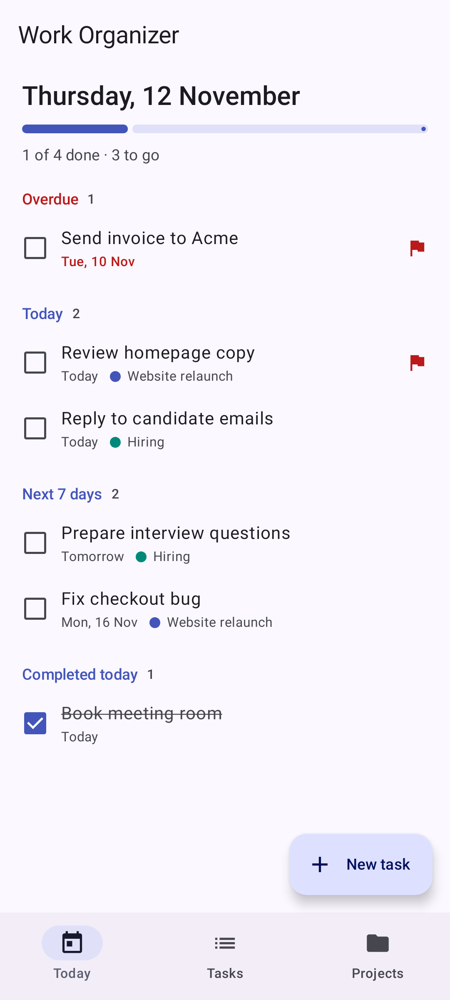
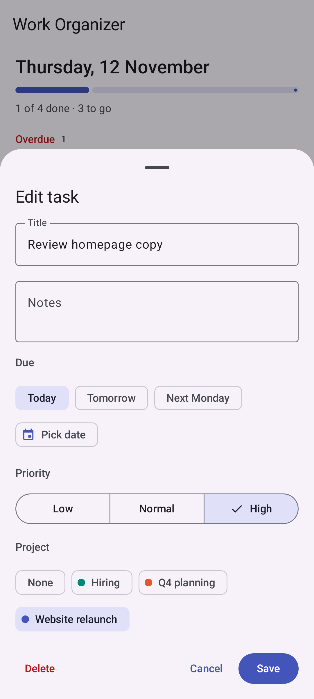
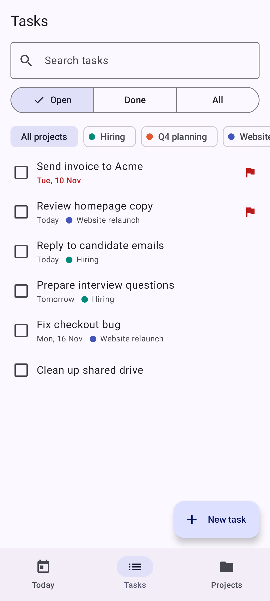
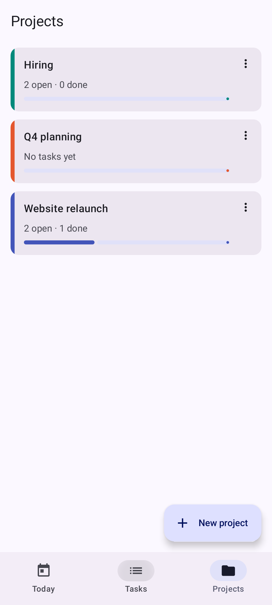

# Work Organizer

An Android app for keeping track of your work: tasks with due dates and priorities, grouped into projects,
with a Today view that shows what needs attention now. Everything is stored on the device; the app needs no
account, network access or permissions.

| Today | Edit task | Tasks | Projects |
| --- | --- | --- | --- |
|  |  |  |  |

## What it does

- **Today** lists overdue tasks, tasks due today, the next 7 days and what you have completed today, with a
  progress bar for the day.
- **Tasks** is the full list, with search (titles and notes), an Open / Done / All switch and a project filter.
  Open tasks are sorted by due date, then priority.
- **Projects** shows each project's open and done counts. Tap a project to see its tasks. Deleting a project
  keeps its tasks and moves them to "No project".
- Each task has a title, notes, a due date (Today, Tomorrow, Next Monday or any date), a priority and an
  optional project. Deleting a task offers Undo.
- Light and dark themes, following the system setting and (on Android 12+) the wallpaper colours.

## Build and install

Requires JDK 17 or newer and the Android SDK (platform 37). Either open the folder in Android Studio and
press Run, or from a terminal:

```sh
export ANDROID_HOME=/path/to/android-sdk
./gradlew :app:assembleDebug          # app/build/outputs/apk/debug/app-debug.apk
./gradlew :app:installDebug           # install on a connected phone or emulator
```

The app runs on Android 8.0 (API 26) and later.

## Tests

```sh
./gradlew :app:testDebugUnitTest                # logic, database and UI tests, all on the JVM
./gradlew :app:testDebugUnitTest -Pscreenshots  # also writes screen PNGs to app/build/screenshots
```

The UI tests run the real screens under Robolectric against an in-memory database, so no device is needed.

## Code layout

| Path | Contents |
| --- | --- |
| `app/src/main/java/com/kabab/work/data` | Room entities (`Task`, `Project`), DAO and database |
| `app/src/main/java/com/kabab/work/domain` | Pure functions: Today buckets, filtering, sorting, date labels |
| `app/src/main/java/com/kabab/work/ui` | Jetpack Compose screens, editors, view model and theme |
| `app/src/test` | Unit, database, UI and screenshot tests |
